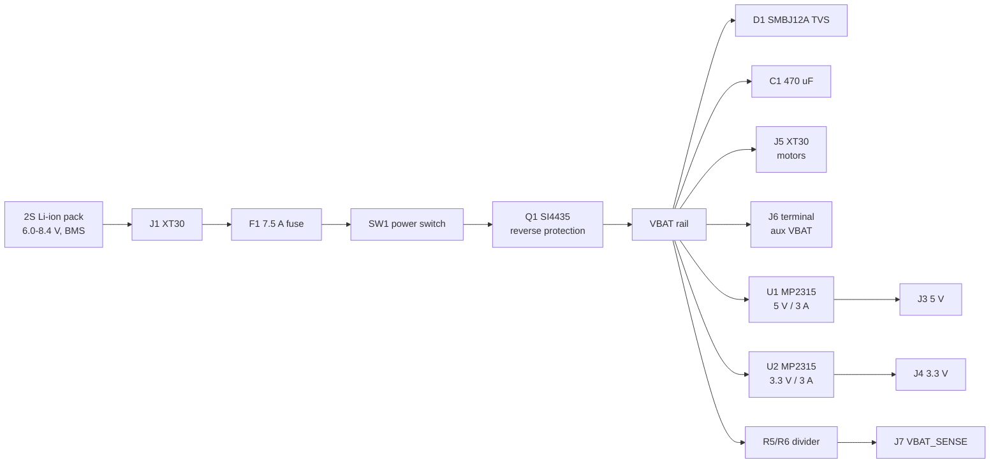

# Power board schematic

## Block diagram



## Input path

| From | To | Notes |
|---|---|---|
| J1.1 | F1.1 | battery positive from the 2S BMS |
| J1.2 | GND | battery negative / common ground |
| F1.2 | SW1.1 | 7.5 A slow-blow fuse |
| SW1.2 | Q1.D | switched battery positive |
| Q1.S | VBAT | protected VBAT rail |
| Q1.G | R10.1 / D5.A / C18.1 | gate node |
| R10.2 | GND | 100 k gate pull-down |
| D5.K | VBAT | 12 V gate-source zener (BZX84C12) |
| C18.2 | VBAT | 100 nF gate-source |
| D1.K | VBAT | SMBJ12A cathode |
| D1.A | GND | SMBJ12A anode |

Q1 is a P-channel MOSFET (SI4435DDY). Drain faces the battery, source faces
the load. This orientation blocks reverse battery polarity. With normal
polarity the body diode starts conduction, the gate is pulled low by R10, and
the FET turns on with low Rds(on).

## 5 V buck — U1 MP2315

| U1 pin | Name | Connection |
|---|---|---|
| 1 | AAM | VCC (pin 7) — forced CCM |
| 2 | IN | VBAT; C2/C3 10 uF/25 V to GND |
| 3 | SW | L1.1, C13.1 |
| 4 | GND | GND, copper pour + vias |
| 5 | BST | R11.2 |
| 6 | EN | R13 100 k to VBAT; optional jumper to GND to disable |
| 7 | VCC | C15 100 nF to GND; AAM tied here |
| 8 | FB | R1/R2 divider, C19 feedforward |

| Ref | Value | Connection |
|---|---|---|
| C2, C3 | 10 uF/25 V X7R 1210 | VBAT to GND, close to pin 2 |
| L1 | 4.7 uH, 5 A | U1.3 to 5 V |
| C13 | 100 nF 0603 | U1.3 to R11.1 |
| R11 | 20 ohm 0603 | C13.2 to U1.5 |
| C15 | 100 nF 0603 | U1.7 to GND |
| R13 | 100 k 1% 0603 | VBAT to U1.6 |
| R1 | 100 k 1% 0603 | 5 V to U1.8 |
| R2 | 19.1 k 1% 0603 | U1.8 to GND |
| C19 | 100 pF 0603 | 5 V to U1.8 |
| C4, C5 | 22 uF/10 V X7R 1206 | 5 V to GND |
| C6 | 100 nF 0603 | 5 V to GND |

Output voltage:

```text
Vout = 0.8 V x (1 + R1/R2)
     = 0.8 x (1 + 100k/19.1k)
     = 4.99 V
```

## 3.3 V buck — U2 MP2315

| U2 pin | Name | Connection |
|---|---|---|
| 1 | AAM | VCC (pin 7) — forced CCM |
| 2 | IN | VBAT; C7/C8 10 uF/25 V to GND |
| 3 | SW | L2.1, C14.1 |
| 4 | GND | GND, copper pour + vias |
| 5 | BST | R12.2 |
| 6 | EN | R14 100 k to VBAT; optional jumper to GND to disable |
| 7 | VCC | C16 100 nF to GND; AAM tied here |
| 8 | FB | R3/R4 divider, C20 feedforward |

| Ref | Value | Connection |
|---|---|---|
| C7, C8 | 10 uF/25 V X7R 1210 | VBAT to GND, close to pin 2 |
| L2 | 4.7 uH, 5 A | U2.3 to 3.3 V |
| C14 | 100 nF 0603 | U2.3 to R12.1 |
| R12 | 20 ohm 0603 | C14.2 to U2.5 |
| C16 | 100 nF 0603 | U2.7 to GND |
| R14 | 100 k 1% 0603 | VBAT to U2.6 |
| R3 | 100 k 1% 0603 | 3.3 V to U2.8 |
| R4 | 32.4 k 1% 0603 | U2.8 to GND |
| C20 | 100 pF 0603 | 3.3 V to U2.8 |
| C9, C10 | 22 uF/10 V X7R 1206 | 3.3 V to GND |
| C11 | 100 nF 0603 | 3.3 V to GND |

Output voltage:

```text
Vout = 0.8 x (1 + 100k/32.4k)
     = 3.27 V
```

## VBAT sense

| Ref | Value | Connection |
|---|---|---|
| R5 | 100 k 1% 0603 | VBAT to J7.1 |
| R6 | 33 k 1% 0603 | J7.1 to GND |
| C17 | 100 nF 0603 | J7.1 to GND |
| J7.1 | VBAT_SENSE | to STM32 ADC |
| J7.2 | GND | |
| J7.3 | 3.3 V | reference for the ADC |

```text
Vsense = VBAT x 33k / (100k + 33k)
6.0 V -> 1.49 V
7.4 V -> 1.84 V
8.4 V -> 2.08 V
```

## Indicators and test points

| Ref | Connection |
|---|---|
| D2 (green) | VBAT -> R7 2.2 k -> GND |
| D3 (green) | 5 V -> R8 1 k -> GND |
| D4 (green) | 3.3 V -> R9 1 k -> GND |
| TP1 | VBAT |
| TP2 | 5 V |
| TP3 | 3.3 V |
| TP4 | GND |
| TP5 | VBAT_SENSE |

## Output connectors

| Ref | Pin 1 | Pin 2 | Pin 3 |
|---|---|---|---|
| J3 5 V | 5 V | GND | — |
| J4 3.3 V | 3.3 V | GND | — |
| J5 VBAT (XT30) | VBAT | GND | — |
| J6 VBAT (terminal) | VBAT | GND | — |
| J7 sense | VBAT_SENSE | GND | 3.3 V |

## Notes

- Place C2/C3 and C7/C8 within a few millimetres of the MP2315 IN/GND pins.
- Keep the SW–L–COUT loop small; the SW node is the noisy node.
- Keep the FB divider next to pin 8 and away from the inductor.
- Tie AAM to VCC for forced CCM; this avoids light-load pulse skipping.
- The MP2315 is internally compensated; no COMP components are required.
- Use 1% resistors for all feedback and sense dividers.
