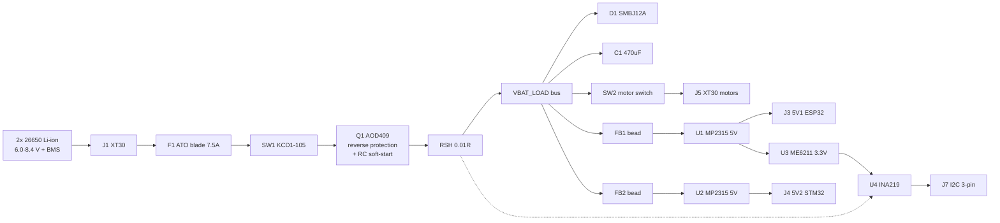

# Power board schematic (v2)

Single A4 sheet, 8 blocks, 64 components, 32 nets. Built by
`easyeda/build_schematic.py`; validated against `netlist.csv` and by a
cross-net wire-collision check.

## Block diagram

## Input path

| From | To | Notes |
|---|---|---|
| J1.1 | F1.1 | battery positive from the pack BMS |
| J1.2 | GND | battery negative / common ground |
| F1.2 | SW1.1 | ATO blade fuse 7.5 A slow-blow |
| SW1.2 | Q1.D | switched battery positive |
| Q1.S | VBAT_RAIL | protected rail, battery side of RSH |
| RSH | VBAT_LOAD | 0.01 ohm shunt; all loads hang off VBAT_LOAD |

Q1 is a P-channel MOSFET (AOD409, TO-252): drain faces the battery, source
faces the load, blocking reverse polarity. R10 (100 k) pulls the gate low
and C18 (100 nF gate-source) gives ~10 ms soft-start against inrush into
the bulk caps; D5 (BZX84C12) clamps gate-source.

## VBAT bus

| Ref | Value | Connection |
|---|---|---|
| D1 | SMBJ12A | VBAT_LOAD to GND (12 V standoff > 8.4 V full charge) |
| C1 | 470 uF 16 V | VBAT_LOAD to GND |
| C12 | 100 nF | VBAT_LOAD to GND |
| C21 | 1 uF | VBAT_LOAD to GND |
| SW2 | KCD1-105 | VBAT_LOAD to VBAT_MOTOR (motor rail switch) |
| J5 | XT30PW-F | 1 = VBAT_MOTOR, 2/3/4 = GND (shield tabs) |

## 5 V buck #1 (U1) -> ESP32 board

MP2315, forced CCM (AAM tied to VCC). Input ferrite FB1, output ferrite FB3.

| U1 pin | Name | Connection |
|---|---|---|
| 1 | AAM | VCC5V1 (pin 7) |
| 2 | IN | VBAT_B1 (after FB1); C2/C3 10 uF/25 V to GND |
| 3 | SW | L1.1, C13.1 |
| 4 | GND | GND |
| 5 | BST | R11.2 |
| 6 | EN | R13 100 k to VBAT_LOAD |
| 7 | VCC | C15 100 nF to GND; AAM tied here |
| 8 | FB | R1/R2 divider, C19 100 pF feedforward |

Output: `Vout = 0.8 x (1 + 100k/19.1k) = 4.99 V`. L1 4.7 uH/5 A, C4/C5
22 uF/10 V + C6 100 nF on the output. J3 (JST-XH 2-pin) takes 5V1_OUT
through FB3.

## 5 V buck #2 (U2) -> STM32 carrier

Identical circuit and netlist to buck #1 with the `_2` suffix
(FB2/C7/C8/C14/R12/C16/R14/C20/L2/C9/C10/C11/R3/R4/FB4/J4, output net
5V2, VCC net VCC5V2). No shared components with buck #1: each board gets
its own fault domain.

## INA219 telemetry + local 3.3 V LDO

| Ref | Value | Connection |
|---|---|---|
| RSH | 0.01 ohm 3 W 2512 | VBAT_RAIL to VBAT_LOAD (in series with everything) |
| U4.8 IN+ | | VBAT_RAIL (battery side) |
| U4.7 IN- | | VBAT_LOAD (load side = bus voltage sense) |
| U4.1/2 A1/A0 | | GND (address 0x40) |
| U4.5 VS | | 3V3I |
| U4.6 GND | | GND |
| U4.3/4 SDA/SCL | | INA_SDA / INA_SCL |
| U3 | ME6211C33 | 5V1 -> 3V3I (VIN=pin1, CE=pin3 tied to 5V1, VSS=GND, VOUT=pin5) |
| C22/C23 | 1 uF | U3 input/output |
| C24 | 100 nF | 3V3I to GND |
| J7 | JST-XH 3-pin | 1 = SDA, 2 = SCL, 3 = GND |

The INA219 is powered locally from 5V1 through the ME6211 (no power
backfeed from the carrier; the power board works standalone). I2C pull-ups
live on the STM32 carrier. Current sign: positive = discharge.

## Indicators and test points

| Ref | Connection |
|---|---|
| D2 + R7 2.2k | VBAT_LOAD -> GND (VBAT on) |
| D3 + R8 1k | 5V1 -> GND |
| D4 + R9 1k | 5V2 -> GND |
| TP1 | VBAT_LOAD |
| TP2 | 5V1 |
| TP3 | 5V2 |
| TP4 | GND |

## Notes

- Place C2/C3 and C7/C8 within a few millimetres of the MP2315 IN/GND pins.
- Keep the SW-L-COUT loop small; the SW node is the noisy node.
- Keep the FB divider next to pin 8 and away from the inductor.
- Tie AAM to VCC for forced CCM; this avoids light-load pulse skipping.
- The MP2315 is internally compensated; no COMP components are required.
- Use 1% resistors for all feedback resistors.
- INA219 shunt (0.01 ohm) gives a ~32 A range at gain 1; expect ~0.1 mV/mA
  resolution. 3 W rating covers 10 A continuous.
- VBAT traces carry the full motor current: >= 3 mm width + pours.
